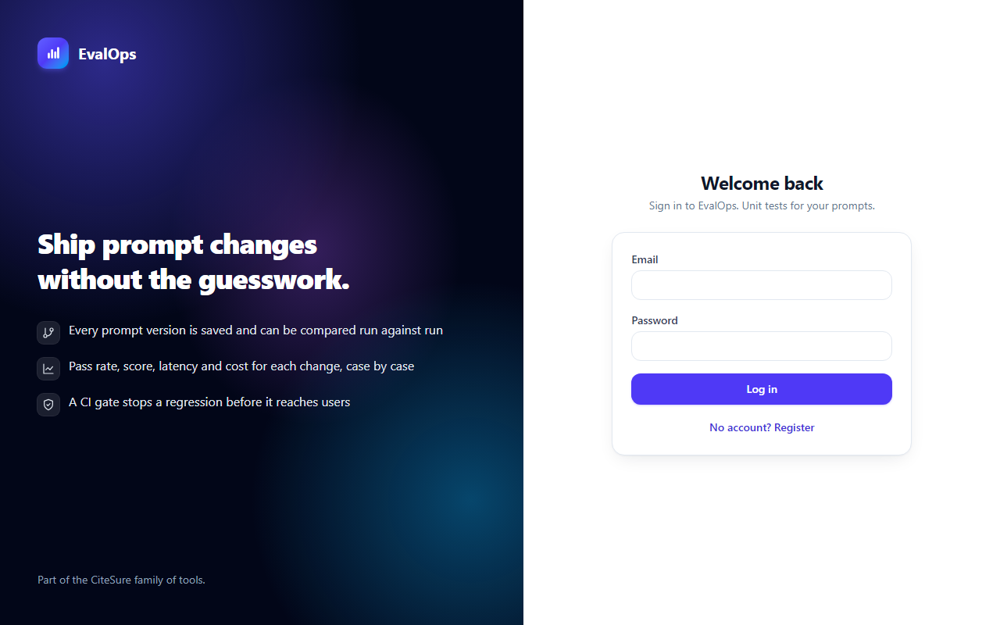
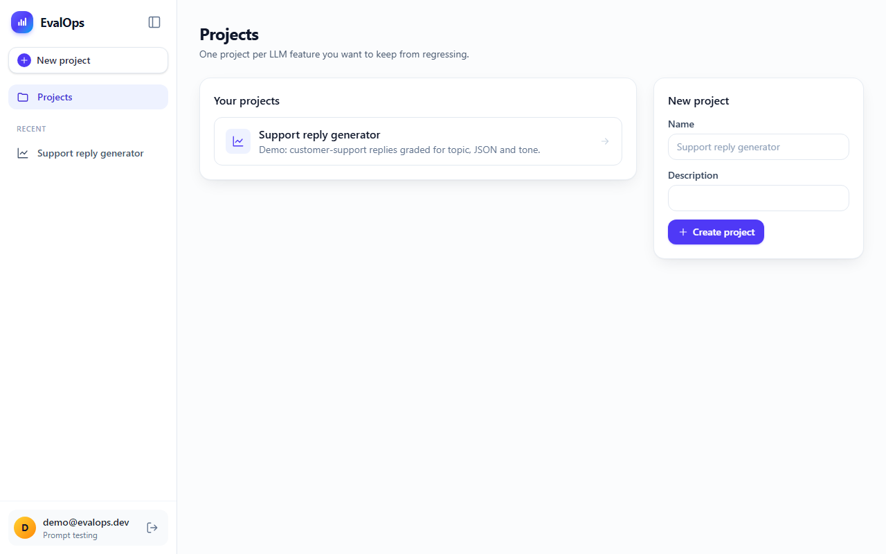
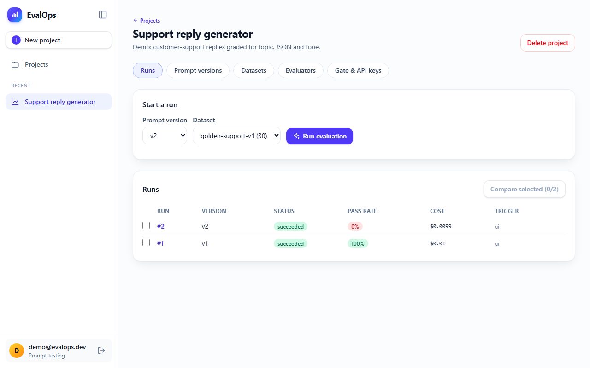
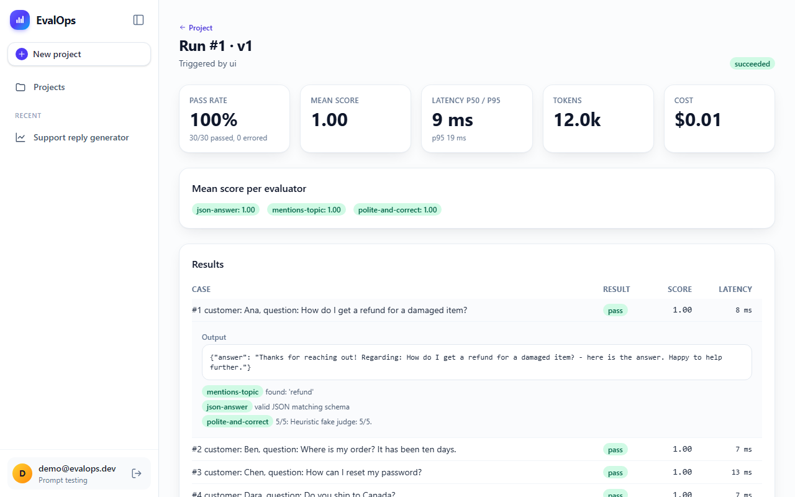
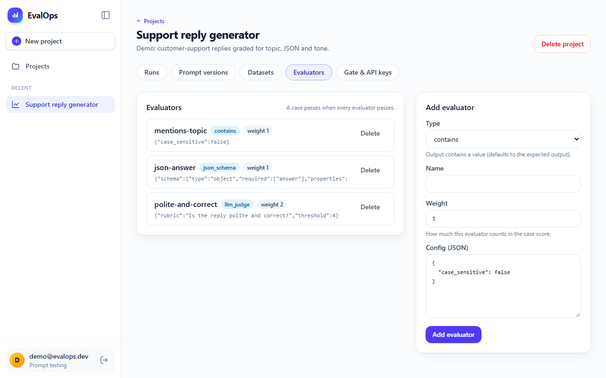
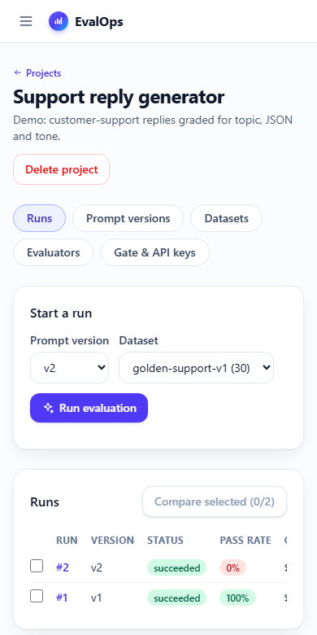

# EvalOps: unit tests for your prompts

**EvalOps** is an LLM regression-testing platform. Version your prompts, keep a golden dataset,
score every output with deterministic checks and an LLM judge, compare two versions case by
case, and block the pull request when quality drops.

> Final project for the DataTalksClub **AI Dev Tools Zoomcamp** (2026). Rubric:
> [docs/rubric.md](docs/rubric.md). Module 5 agent extension pack: [docs/agent-extension-pack.md](docs/agent-extension-pack.md).
> Live demo: _add URL after first deploy, see [docs/deployment.md](docs/deployment.md)_.


## The problem

Teams ship prompt changes the way people shipped code before unit tests: edit the prompt,
eyeball three outputs, deploy, hope. Regressions such as wrong answers, broken JSON, a rude
tone or a cost spike are found by users, not by CI.

## What EvalOps does

1. **Version prompts**: template with `{{variables}}`, model and parameters. Versions are immutable.
2. **Golden datasets**: test cases with inputs, expected output and tags; CSV/JSONL import
   with per-row error reports.
3. **Evaluators**: `exact_match`, `contains`, `regex`, `json_schema` and `llm_judge`
   (1–5 rubric score, structured output, prompt-injection-hardened). Weighted; a case passes
   when all of its evaluators pass.
4. **Runs**: a background worker executes every case, scores it and reports pass rate,
   per-evaluator means, p50/p95 latency, tokens and cost, with live progress in the UI.
   Per-run case and spend caps, plus a daily budget per project.
5. **Compare**: per-case diff between two runs (regressed / improved / unchanged), with
   side-by-side outputs and CSV export of the filtered cases.
6. **CI gate**: `POST /api/v1/gate` with a project API key → `pass`/`fail` plus reasons; the
   GitHub Action fails the PR when the pass rate, regression count or cost increase break the
   project's policy.

### Expected behaviour (happy path, automated by the E2E test)

Sign up → create _Support reply generator_ → save prompt `v1` → import 30 cases → attach
`contains`, `json_schema` and `llm_judge` → run: **100% pass** → save a "shorter" `v2` → run:
**0% pass** → _Compare v1 → v2_: **30 cases regressed**, outputs side by side → CI gate on
`v2`: **FAIL** (exit 1) with reasons.

## Screenshots

| Sign in | Projects |
|---|---|
|  |  |

| Runs: v1 passes 100%, v2 passes 0% | Run detail: scores, latency, cost, per-evaluator reasons |
|---|---|
|  |  |

| Evaluators | On a phone |
|---|---|
|  |  |

The screenshots come from the seeded demo and are regenerated by
[e2e/scripts/screenshots.mjs](e2e/scripts/screenshots.mjs) (see [Run it (local development)](#run-it-local-development)).

### The interface

The UI shares its design system with [CiteSure](../CiteSure/), so the two apps read as one product family:

- **Same tokens**: indigo brand colours, rounded cards with soft shadows, system fonts only
  (nothing is fetched from a third party to render a page), and a reduced-motion fallback.
- **App shell**: a collapsible sidebar (remembered per browser) with your projects as quick
  links; on a phone it becomes a drawer. The sign-in page uses the same split hero as CiteSure.
- **Readable at a glance**: green / amber / red badges for pass rate and status, stat tiles for
  pass rate, latency, tokens and cost, and tables that scroll sideways on small screens.
- **Accessible markup**: labelled form controls, `role="tab"` tabs and filters, `role="alert"` errors,
  and focus styles on buttons and inputs (the frontend tests rely on these roles).

## Architecture

```text
Browser ─▶ (Caddy TLS) ─▶ nginx: React SPA + /api proxy ─▶ FastAPI ─▶ PostgreSQL ◀─ Worker ─▶ LLMProvider
                                                             ▲          (jobs table,        ├ Anthropic (prod)
GitHub Actions / MCP server / triage agent ── X-API-Key ─────┘     SELECT … SKIP LOCKED)    └ Fake (tests, CI, demo)
OpenTelemetry ─▶ Collector ─▶ Tempo · Prometheus · Alloy ─▶ Loki ─▶ Grafana (dashboard) · Alertmanager (routing)
```

| Layer | Technology | Role |
|---|---|---|
| Frontend | React 18 + TypeScript + Vite, TanStack Query, React Router 7, Tailwind 4 | UI, styled with the same design tokens as CiteSure; **all** API calls go through a client generated from `openapi.yaml` and wrapped in query hooks (`frontend/src/api/`) |
| API contract | OpenAPI 3.1 (`openapi.yaml`) | Source of truth: Spectral lint in CI, generated TS types, backend drift test |
| Backend | Python 3.12, FastAPI, Pydantic v2, async SQLAlchemy 2, Alembic | Layered `api → services → repositories`; JWT for users, hashed project API keys for machines |
| Worker | same image, `python -m app.worker` | Postgres job queue, bounded concurrency, per-run and daily spend caps |
| LLM | Anthropic SDK behind `LLMProvider` | `claude-opus-5-5` by default (`DEFAULT_MODEL`, `JUDGE_MODEL`); FakeProvider for tests and demo |
| Database | PostgreSQL 16 (dev/prod), SQLite (unit tests) | selected by `DATABASE_URL`; migrations with Alembic |
| Containers | Docker, Docker Compose | `db`, `migrate`, `api`, `worker`, `frontend` (+ `caddy` in prod) |
| CI/CD | GitHub Actions → GHCR → EC2 | test → build → scan → deploy → health check; eval gate; nightly triage |
| Observability | OpenTelemetry, Prometheus, Tempo, Loki + Alloy, Grafana, Alertmanager | `ops/`: one trace per run (API → worker → LLM), JSON logs in Loki linked to traces by `trace_id`, dashboard, 4 alerts routed by severity, runbook |
| Agent pack | Claude Code skills, subagents, hooks, MCP, plugin, custom agent | see below |

More: [docs/architecture.md](docs/architecture.md).

## Run it (Docker, recommended)

Requirements: Docker with Compose v2.

```bash
docker compose up -d --build --wait                 # db, migrations, api :8000, worker, UI :5173
docker compose run --rm api python -m app.seed      # demo project, 30 cases, runs for v1 and v2
```

Open <http://localhost:5173> and log in as `demo@evalops.dev` with the `DEMO_PASSWORD` from
[.env.example](.env.example), or register your own account. API docs: <http://localhost:8000/api/docs>.

No API key is needed: `LLM_PROVIDER=fake` is the default. To use Claude:
`LLM_PROVIDER=anthropic ANTHROPIC_API_KEY=sk-... docker compose up -d` (spend is capped by
`MAX_COST_PER_RUN_USD`, default $2 per run, and `MAX_DAILY_COST_USD`, default $20 per project per day).

With observability: `docker compose -f docker-compose.yml -f ops/docker-compose.observability.yml up -d --build`
→ Grafana <http://localhost:3000>, Prometheus <http://localhost:9090>, Alertmanager <http://localhost:9093>
(delivered alerts: `docker compose -f docker-compose.yml -f ops/docker-compose.observability.yml logs alert-sink`).
Logs: Grafana → Explore → Loki, e.g. `{service="worker"} | json | run_id="24"`; the `trace_id` field links to the run's trace in Tempo.

## Run it (local development)

```bash
# backend (Python 3.12 via uv)
cd backend && uv sync
uv run alembic upgrade head            # SQLite file by default; set DATABASE_URL for Postgres
uv run uvicorn app.main:app --reload   # :8000
uv run python -m app.worker            # second terminal
uv run python -m app.seed              # optional demo data

# frontend
cd frontend && npm ci && npm run dev   # :5173, proxies /api to :8000
npm run mock                           # alternative: Prism mock of openapi.yaml on :8000 (no backend needed)

# refresh the README screenshots (stack seeded with `python -m app.seed` and the worker running)
cd e2e && npm ci && npx playwright install chromium
node scripts/screenshots.mjs           # set E2E_BASE_URL if the UI is not on :5173; writes docs/screenshots/
```

Configuration: every variable is documented in [.env.example](.env.example) and validated
by `backend/app/config.py`.

## Test it

| Suite | Command | What it covers |
|---|---|---|
| Backend unit (81) | `cd backend && uv run pytest -m "not integration"` | SQLite, < 30 s: pure logic, evaluators, providers, auth, every endpoint, worker, compare, gate, **contract drift** |
| Backend integration (3) | `cd backend && uv run pytest -m integration` | needs Docker: Postgres 16 via testcontainers + Alembic; import → run → compare → gate; `SKIP LOCKED` with 4 concurrent workers; cascades |
| Coverage | `cd backend && uv run pytest --cov=app` | 90% |
| Frontend (33) | `cd frontend && npm run test` (`npm run coverage`) | formatting, compare filtering/sorting/diffing, CSV export, API client auth and errors, CompareTable, LoginPage, EvaluatorsTab |
| E2E (1 journey) | `docker compose up -d --wait && docker compose run --rm api python -m app.seed && cd e2e && npm ci && npx playwright install chromium && npx playwright test` | the full happy path through the real UI and worker |
| MCP server (7) | `cd mcp-server && uv run pytest` | tools, scoping, truncation, errors, resource, prompt |
| Hooks (9) | `python -m unittest discover -s agent-hooks/tests` | secrets, migrations, contract approval, destructive commands, stop hook |
| Lint / types | `cd backend && uv run ruff check . && uv run mypy app tests`; `cd frontend && npm run lint && npm run typecheck` | |
| Contract | `npx @stoplight/spectral-cli@6 lint openapi.yaml` | |
| Judge calibration | `cd backend && uv run python -m app.evaluators.calibrate` | agreement with labels (FakeProvider: 100%, a pipeline check only; real-model agreement not measured yet, see [calibration README](backend/app/evaluators/calibration/README.md)) |

## Use it in CI

```bash
EVALOPS_API_KEY=eo_... python scripts/evalops_gate.py --url https://evalops.example.com \
  --dataset-id 1 --head-label "pr-$PR-$SHA" --template-file prompts/support-reply.txt --baseline-label v1
```

Exit 0 = pass, 1 = fail (reasons printed and written to the GitHub step summary).
This repository dogfoods it in [.github/workflows/eval-gate.yml](.github/workflows/eval-gate.yml).

## Deploy it

AWS EC2 + Docker Compose + Caddy (automatic HTTPS), rolled out by
[.github/workflows/deploy.yml](.github/workflows/deploy.yml) after CI is green on `main`:
images → GHCR → Trivy → SSH `compose pull && up -d --wait` (migrations run first) → health
check. One-time setup and rollback: [docs/deployment.md](docs/deployment.md).

No AWS account? Run it for free on your own machine (`docker-compose.selfhost.yml`) and, if CI needs to reach it, publish it through Tailscale Funnel or Cloudflare Tunnel: [docs/free-deployment.md](docs/free-deployment.md). CiteSure's CI gate was run against this stack (see CiteSure `docs/evalops-integration.md`).

## CI/CD

| Workflow | Trigger | Jobs |
|---|---|---|
| [ci.yml](.github/workflows/ci.yml) | PR, push to main | contract (Spectral + generated client up to date), backend (ruff, mypy, unit, integration, calibration), frontend (lint, types, tests, build), agent pack (sync check, hook tests, MCP tests), E2E (compose + Playwright), security (gitleaks, Semgrep, Trivy, pip-audit, npm audit) |
| [deploy.yml](.github/workflows/deploy.yml) | CI success on main | build + push images, scan, deploy, health check |
| [eval-gate.yml](.github/workflows/eval-gate.yml) | PRs touching prompts | judge calibration ≥ 80%; product prompt must pass the EvalOps gate vs `v1` |
| [nightly-triage.yml](.github/workflows/nightly-triage.yml) | cron | custom agent re-evaluates and opens an issue on regression |

## Agent extension pack (Module 5)

| Requirement | Implementation |
|---|---|
| Project instructions | [AGENTS.md](AGENTS.md) (portable) + [CLAUDE.md](CLAUDE.md) |
| Reusable workflows | skills [add-eval-case](agent-capabilities/add-eval-case/SKILL.md), [review-api-change](agent-capabilities/review-api-change/SKILL.md), [debug-ci-failure](agent-capabilities/debug-ci-failure/SKILL.md) |
| Specialised subagents | [api-contract-reviewer](agent-capabilities/subagents/api-contract-reviewer.md) (read-only), [eval-reviewer](agent-capabilities/subagents/eval-reviewer.md), [qa-tester](agent-capabilities/subagents/qa-tester.md) |
| MCP server | [mcp-server/](mcp-server/): 7 tools (6 read-only + `start_run`), resource `evalops://runs/{id}`, prompt `triage-regression`, one project key |
| Hooks / guardrails | [agent-hooks/](agent-hooks/): block secrets, committed migrations, the generated client, unreviewed contract edits and destructive commands; format on save; tests before stop; audit log |
| Plugin | [plugins/evalops-agent-pack/](plugins/evalops-agent-pack/) (validated with `claude plugin validate`) |
| Custom agent | [custom-agent/](custom-agent/): nightly regression triage → GitHub issue |
| Permission notes | [docs/permissions.md](docs/permissions.md), [security/agent-threat-model.md](security/agent-threat-model.md) |
| Demo | [docs/demo.md](docs/demo.md) |

## Security, audit and operations

[security/README.md](security/README.md): gitleaks, Semgrep, Trivy, pip-audit and npm audit
results before and after fixes · [AI PR audit](security/pr-audit.md) with decisions ·
[agent threat model](security/agent-threat-model.md) · [AI data policy](security/ai-data-policy.md) ·
[outage drill](security/ops-drill/README.md) · [runbook](docs/runbook.md).

## How AI was used

Built with Claude Code from [plan.md](plan.md) and [CLAUDE.md](CLAUDE.md): spec → contract →
small slices with tests in the loop → integration, E2E, real scans and an outage drill.
Every step, prompt, finding and human decision is in [docs/ai-workflow.md](docs/ai-workflow.md).
A beginner-friendly build guide is in [substack/](substack/).

## Repository map

```text
openapi.yaml  product-spec.md  plan.md  AGENTS.md  CLAUDE.md
frontend/  backend/  e2e/  scripts/  prompts/
docker-compose.yml  docker-compose.prod.yml  deploy/  .github/workflows/
ops/  security/  docs/  substack/
agent-capabilities/  agent-hooks/  mcp-server/  plugins/  custom-agent/  .claude/  .mcp.json
```

## License

MIT
