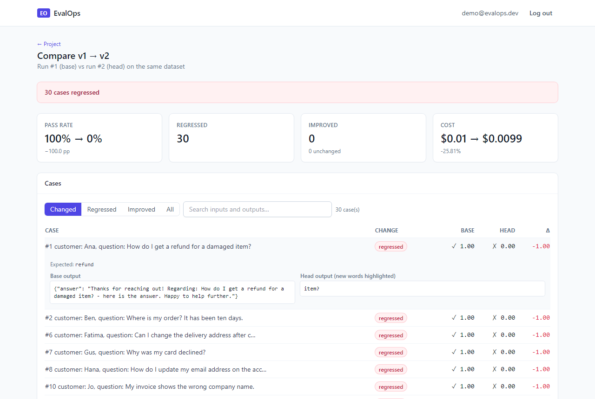

# Building EvalOps: Unit Tests for Your Prompts

*A step-by-step series on building a production-style AI engineering project with a coding agent, from a one-paragraph idea to a deployed, monitored, secured app with its own agent extension pack.*

---

Most AI tutorials stop at "call the model and print the answer." Real AI engineering starts after that: how do you know your prompt change made things **better**? How do you stop a bad prompt from reaching users? How do you let a coding agent help without letting it break things?

In this series I build **EvalOps**, an LLM regression-testing platform, and explain every concept along the way for readers who are new to it. It's the final project for the DataTalksClub *AI Dev Tools Zoomcamp*, and the kind of project that shows an AI engineering hiring manager you can ship, not just prototype.

**What EvalOps does, in one paragraph.** You save versions of a prompt. You keep a "golden dataset" of test cases. EvalOps runs every case through the model, scores each output with simple checks and an LLM judge, shows you which cases got worse between two versions, and fails your GitHub pull request when quality drops. It's unit testing for prompts.

## The series

| # | Post | You will learn |
|---|---|---|
| 1 | [From vague idea to spec: AI-native project kickoff](01-idea-to-spec.md) | specs as prompts, context files (AGENTS.md / CLAUDE.md), slicing a backlog |
| 2 | [Contract-first development: why OpenAPI keeps AI-generated code honest](02-contract-first.md) | OpenAPI, generated clients, mock servers, drift tests |
| 3 | [Building a FastAPI backend from a contract with a coding agent](03-backend.md) | layered architecture, async SQLAlchemy, migrations, auth, API keys |
| 4 | [How to evaluate LLM output: deterministic checks vs LLM-as-judge](04-evaluating-llm-output.md) | evaluators, judges, prompt injection, calibration ("judging the judge") |
| 5 | [Unit tests for prompts: gating pull requests on LLM quality](05-ci-gate.md) | job queues, comparisons, regressions, a CI gate |
| 6 | [A testing pyramid for AI apps: what to mock and what never to mock](06-testing-pyramid.md) | fake LLM providers, unit vs integration vs E2E |
| 7 | [Shipping it: Docker Compose, GitHub Actions and AWS](07-shipping.md) | containers, CI/CD, deployment, rollbacks |
| 8 | [Observability for LLM apps: tracing tokens and dollars](08-observability.md) | metrics, traces, dashboards, alerts, an outage drill |
| 9 | [Skills vs subagents vs MCP vs hooks: a mental model](09-agent-extension-mental-model.md) | how coding agents are extended and constrained |
| 10 | [Building an MCP server for your own app](10-mcp-server.md) | tools, resources, prompts, scoping |
| 11 | [Threat-modeling an AI app (including your own coding agents)](11-security.md) | real scanner results, prompt injection, data policy |
| 12 | [What I'd tell you before you start](12-lessons.md) | lessons, numbers, what I'd do differently |

## Who this is for

- You know some Python and a little JavaScript.
- You've called an LLM API before, or are about to.
- You want to understand *why* things are built the way they are, not just copy code.

## The stack

React + TypeScript + Vite, FastAPI + SQLAlchemy + Postgres, the Anthropic SDK (Claude) behind
a provider interface, Docker Compose, GitHub Actions, AWS EC2, OpenTelemetry + Prometheus +
Grafana, and Claude Code as the coding agent, extended with skills, subagents, hooks, an MCP
server and a plugin.

All the code is in the repo. Every post links to the exact files.
